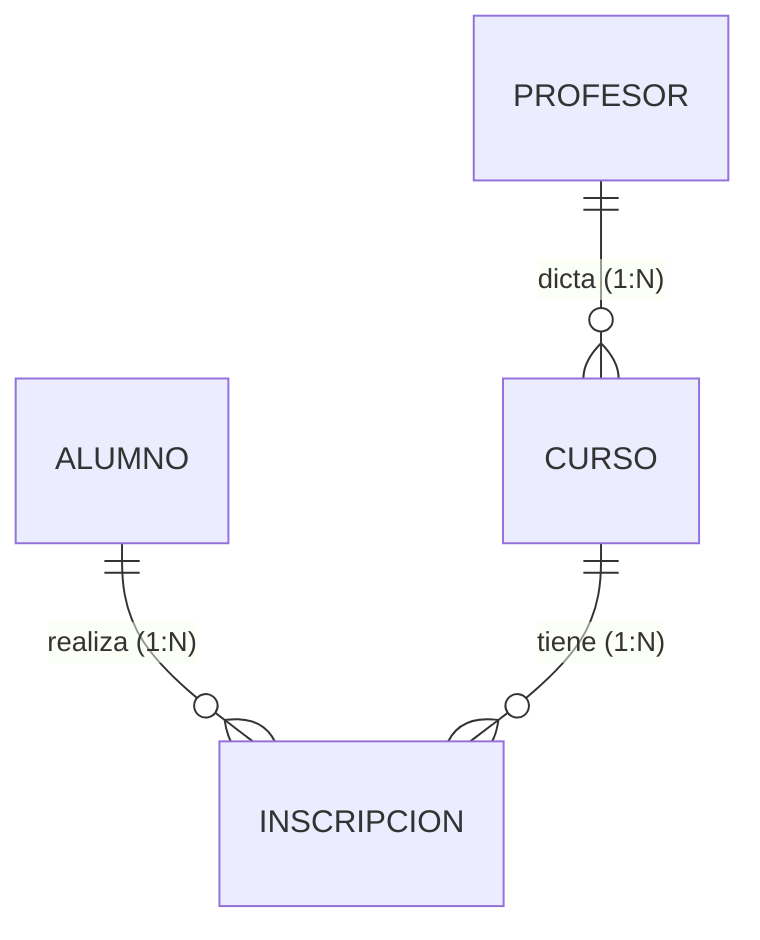
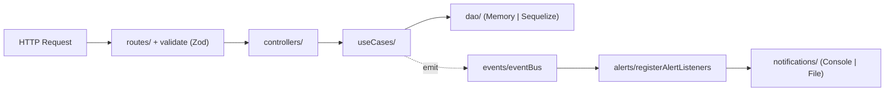

# Gestión de Cursos — API REST — TP2-Grupo-1

API REST para administrar alumnos, profesores, cursos e inscripciones con control de cupos, reglas de negocio desacopladas, persistencia intercambiable (memoria o SQLite) y notificaciones por eventos.

---

## Dominio y entidades

El sistema modela la inscripción de alumnos a cursos dictados por profesores:

- **Profesor:** docente titular con `nombre`, `email` y `especialidad` únicos. No puede eliminarse si tiene cursos asignados.
- **Curso:** materia o taller con `nombre`, `descripcion`, `cupo_maximo`, `cupo_disponible` y un profesor asignado (`profesorId`). Al eliminarse un curso, se eliminan en cascada sus inscripciones asociadas.
- **Alumno:** estudiante identificado por `nombre`, `apellido`, `email` único y `legajo` único. No puede eliminarse si tiene inscripciones activas.
- **Inscripción:** vincula un alumno con un curso. Valida existencia de ambos, impide inscripciones duplicadas, verifica cupo disponible y actualiza `cupo_disponible` automáticamente al inscribirse o darse de baja.

### Relaciones



- **Profesor (1) — (N) Curso:** un profesor puede dictar varios cursos; cada curso tiene un único profesor titular.
- **Alumno (N) — (M) Curso:** un alumno puede inscribirse a varios cursos y un curso tiene muchos alumnos, materializado mediante la tabla/entidad intermedia **Inscripción**.

---

## Requisitos

- **Node.js `>= 20.6.0`** (recomendado **Node 22+**), requerido por las flags nativas `--env-file` y `--watch`.
- **npm** (incluido con Node.js).

---

## Puesta en marcha

1. **Clonar el repositorio e ingresar a la carpeta:**
   ```bash
   git clone [https://github.com/Manugrinspon/Proyecto-TP2-Grupo-1.git](https://github.com/Manugrinspon/Proyecto-TP2-Grupo-1.git)
   cd Proyecto-TP2-Grupo-1
   ```

2. **Instalar dependencias:**
   ```bash
   npm install
   ```

3. **Crear el archivo de variables de entorno `.env` a partir del ejemplo:**
   - En **Linux / macOS / Git Bash**:
     ```bash
     cp .env.example .env
     ```
   - En **Windows (PowerShell / CMD)**:
     ```powershell
     copy .env.example .env
     ```

4. **Levantar el servidor en modo desarrollo (con reinicio automático):**
   ```bash
   npm run dev
   ```
   O en modo estándar:
   ```bash
   npm start
   ```

Al arrancar, ambos modos de persistencia cargan datos iniciales de prueba (2 alumnos, 2 profesores y 2 cursos) para poder probar la API de inmediato.

---

## Variables de entorno

| Variable | Por defecto | Valores / Tipo | Descripción |
| --- | --- | --- | --- |
| `PORT` | `8000` | Entero | Puerto HTTP en el que escucha Express. |
| `NODE_ENV` | `development` | `development` \| `production` | Entorno de ejecución. |
| `PERSISTENCE_TYPE` | `memory` | `memory` \| `sequelize` | Adaptador de persistencia seleccionado por `daoFactory`. |
| `NOTIFIER_TYPE` | `console` | `console` \| `file` | Canal de salida para las alertas de dominio. |
| `NOTIFICATIONS_LOG_PATH` | `notifications.log` | Ruta de archivo | Archivo donde se escriben las notificaciones cuando `NOTIFIER_TYPE=file`. |
| `CUPO_BAJO_UMBRAL` | `2` | Entero | Cantidad de lugares restantes a partir de la cual se dispara el evento `curso_cupo_bajo`. |

> El archivo `.env` está excluido en `.gitignore` y no debe versionarse.

---

## Cambio de persistencia

Cambiar entre memoria y base de datos real no requiere modificar rutas, controladores ni casos de uso.

1. Editá `PERSISTENCE_TYPE` en tu archivo `.env`:
   - **En memoria (arrays de JS):** `PERSISTENCE_TYPE=memory`
   - **Base de datos SQLite (Sequelize ORM):** `PERSISTENCE_TYPE=sequelize`
2. Reiniciá el servidor (`npm run dev` o `npm start`).

La factory (`dao/daoFactory.js`) inyecta el adaptador correspondiente desde el contenedor (`container/container.js`). En modo `sequelize`, el archivo `database.sqlite` se crea automáticamente en la raíz al iniciar (también ignorado por Git). Ambos modos devuelven objetos planos de JavaScript y responden con los mismos códigos HTTP y formatos.

---

## Documentación de la API (Swagger / OpenAPI)

El contrato completo de todos los endpoints —métodos, parámetros de ruta y query, cuerpos de ejemplo, schemas reutilizables y códigos de error (`400`, `404`, `409`, `500`)— está publicado con **Swagger UI** en:

**`http://localhost:8000/api-docs`**

| Recurso | Ruta base | Capacidades principales |
| --- | --- | --- |
| Alumnos | `/alumnos` | CRUD completo, filtros (`nombre`, `email`, `legajo`), ordenamiento y paginación |
| Profesores | `/profesores` | CRUD completo, filtros (`nombre`, `email`, `especialidad`), ordenamiento y paginación |
| Cursos | `/cursos` | CRUD completo, filtros (`nombre`, `profesorId`), ordenamiento, paginación y borrado en cascada |
| Inscripciones | `/inscripciones` | Alta, baja (con devolución de cupo), listado con relaciones y filtros (`alumnoId`, `cursoId`) |

Adicionalmente, el archivo `requests.http` en la raíz incluye una colección de pedidos listos para ejecutar con la extensión **REST Client** de VS Code (modificá `@host` en la primera línea si cambiás el puerto).

---

## Sistema de eventos y notificaciones

El contenedor crea un bus de eventos (`events/eventBus.js`, basado en `EventEmitter`) y lo inyecta en los casos de uso para desacoplar las reglas de negocio de los efectos secundarios. Los listeners viven en `alerts/registerAlertListeners.js` y capturan sus propios errores (`safe()`) para que un fallo en la notificación nunca interrumpa una operación de negocio.

| Evento emitido | Cuándo se dispara | Qué hace el listener |
| --- | --- | --- |
| `inscripcion_creada` | Al concretarse una inscripción en `createInscripcion`. | Envía una notificación con el alumno, el curso y los cupos restantes (`cupo_disponible/cupo_maximo`). |
| `curso_cupo_bajo` | Cuando, tras inscribir un alumno, `cupo_disponible <= CUPO_BAJO_UMBRAL`. | Envía una alerta de cupo bajo indicando los lugares disponibles sobre el cupo máximo. |

La salida depende de `NOTIFIER_TYPE`:
- `console` (`notifications/consoleNotifier.js`): imprime las alertas en la terminal del servidor.
- `file` (`notifications/fileNotifier.js`): agrega una línea con fecha ISO en el archivo configurado en `NOTIFICATIONS_LOG_PATH`.

---

## Arquitectura

El proyecto aplica **Arquitectura en Capas** con **Inversión de Dependencias** y un único **Composition Root** (`container/container.js`):



| Carpeta | Responsabilidad |
| --- | --- |
| `config/` | Lectura centralizada de variables de entorno con defaults. |
| `container/` | Composition Root: instancia DAOs, bus de eventos, listeners, casos de uso, controladores y routers. |
| `routes/` | Definición de rutas Express y middlewares de validación. |
| `schemas/` | Esquemas de validación Zod para `body`, `query` y `params`. |
| `controllers/` | Traducción entre HTTP (`req`/`res`) y casos de uso, sin lógica de negocio. |
| `useCases/` | Reglas de negocio puras; reciben DAOs y eventos por parámetro. |
| `dao/` | Adaptadores intercambiables (Memory y Sequelize), modelos ORM y `daoFactory.js`. |
| `connection/` | Configuración de la instancia de Sequelize (SQLite). |
| `events/`, `alerts/`, `notifications/` | Bus de eventos, listeners con captura de errores y adaptadores de notificación. |
| `middlewares/` | Logger de requests, validador genérico de Zod, `notFound` (404) y `errorHandler` unificado. |
| `errors/` | Clase `AppError` para errores de dominio con `code`, `message`, `statusCode` y `details`. |
| `docs/` | Especificación OpenAPI 3.0.0 (`swagger.js`) servida en `/api-docs`. |

---

## Scripts disponibles

| Comando | Descripción |
| --- | --- |
| `npm run dev` | Inicia el servidor cargando `.env` con reinicio automático (`--watch`). |
| `npm start` | Inicia el servidor cargando `.env` sin `--watch`. |
| `npm test` | Ejecuta la suite de tests con Vitest (`vitest run`). |
| `npm run test:watch` | Ejecuta Vitest en modo interactivo. |
| `npm run coverage` | Ejecuta Vitest con reporte de cobertura. |

---

## Limitaciones conocidas

- **Sin autenticación ni autorización:** todos los endpoints son públicos.
- **Sin transacciones atómicas en inscripciones:** el alta de inscripción y el descuento de `cupo_disponible` se ejecutan en dos operaciones secuenciales; ante pedidos concurrentes sobre el último lugar podría darse una condición de carrera.
- **Sincronización de esquema en SQLite:** los DAOs usan `sequelize.sync()` sin migraciones; ante cambios de columnas en los modelos hay que regenerar `database.sqlite`.
- **JSON mal formado en el body:** un error de sintaxis al parsear el JSON de entrada cae en el `errorHandler` como `500 INTERNAL_ERROR` en lugar de `400`.

---

## Problemas frecuentes

| Síntoma | Causa | Solución |
| --- | --- | --- |
| Error al arrancar indicando que no existe `.env` (`ENOENT`) | `npm start` / `npm run dev` usan `--env-file=.env` y el archivo no fue creado. | Crear `.env` copiando `.env.example` (ver paso 3 de *Puesta en marcha*). |
| `SQLITE_ERROR: table ... has no column named ...` | El archivo local `database.sqlite` quedó generado con una versión anterior de los modelos. | Frenar el servidor, borrar `database.sqlite` y volver a iniciar con `npm run dev`. |
| `EADDRINUSE: address already in use :::8000` | Otro proceso está ocupando el puerto `8000`. | Cerrar el proceso previo o cambiar `PORT` en `.env`. |
| En modo `memory` los datos creados desaparecen al guardar un archivo | `node --watch` reinicia el proceso completo y limpia la memoria. | Comportamiento esperado en modo memoria; usar `PERSISTENCE_TYPE=sequelize` para persistir entre reinicios. |